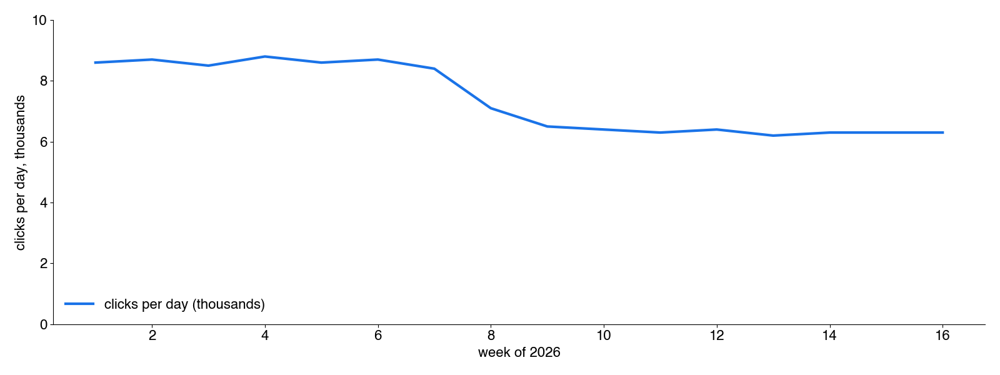
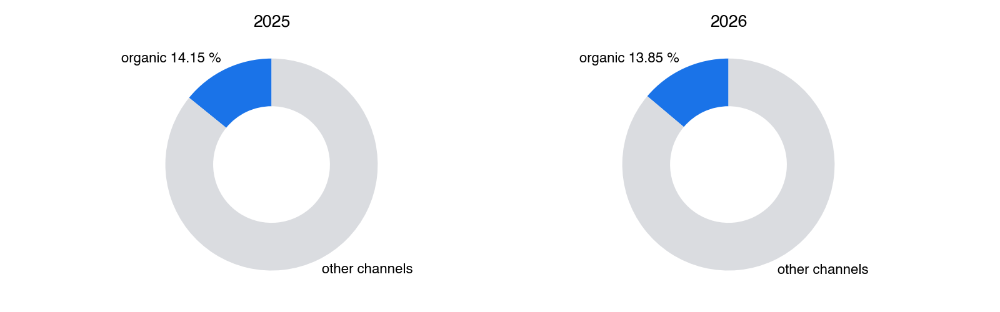

<!-- _class: title -->

# Data slides
## Headline, tags, logos, context and conclusion are native text

---

# Search Console: example.com clicks per day
Tags: 16 weeks
Logos: gsc | search
Context: weeks 1-16 of 2026, all queries, web search, Germany
Conclusion: Clicks fell from 8,600 to 6,300 a day (-27 %) in week 8 and stayed there
Notes: Say first what the chart shows, then the drop.

Source: [Search Console, Performance report, exported 9 Nov 2026](https://search.google.com/search-console)

---

# Google Analytics: sessions by channel
Tags: 28 days | YoY
Logos: ga4
Context: 13 Oct - 9 Nov 2026 vs 14 Oct - 10 Nov 2025, same weekdays
Conclusion: Organic share 14.15 % -> 13.85 % (-0.30 pp): 12,614,687 -> 11,145,246 sessions

| channel | 2025 | 2026 | change |
| --- | ---: | ---: | ---: |
| Organic search | 12,614,687 | 11,145,246 | -11.6 % |
| All channels | 89,149,000 | 80,456,931 | -9.7 % |

Source: GA4 Explore export, property 123456, 10 Nov 2026

---

# Two ways to split branded and non-branded queries
Tags: method
Logos: gsc
Conclusion: Both splits agree within 2 % on the 16-month total (4.1M of 5.3M clicks non-branded)

- (A) Our calculation: brand regex on named queries
- (B) Search Console's own "Branded queries" filter
- (A) misses anonymised queries, (B) starts 21 Feb 2026

Source: [Search Console help: branded queries filter](https://support.google.com/webmasters/answer/7576553)
